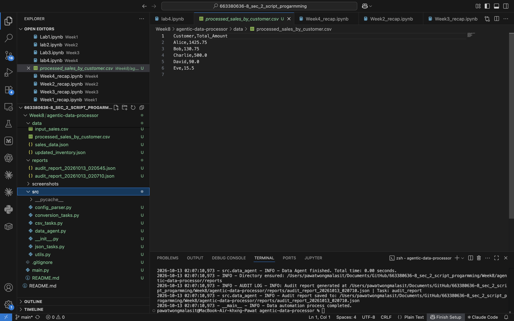

# Week 8 LabX ADV: Agentic Data Processing (Advanced CSV & JSON Workflows)

An "Agentic Data Processor" that runs a multi-step CSV/JSON data pipeline defined in a
declarative JSON config (`configs/data_pipeline_config.json`). Each task reads its input from
the agent's internal `data_store` (`input_data_key`) and writes its result back
(`output_data_key`), so tasks can be chained.

## Results (screenshots)

### Terminal output (`python main.py`)


### `data/processed_sales_by_customer.csv`


### `data/sales_data.json`


### `data/updated_inventory.json`


## Pipeline

| # | Task | Type | Result |
|---|------|------|--------|
| 1 | Load Sales Data CSV | `load_csv` | `raw_sales_data` (10 rows) |
| 2 | Aggregate Sales by Customer | `transform_csv_aggregate` | `customer_sales_summary` (sum of `Amount` per `Customer`) |
| 3 | Save Aggregated Sales CSV | `save_csv` | `data/processed_sales_by_customer.csv` |
| 4 | Convert Raw Sales to JSON | `csv_to_json_conversion` | `raw_sales_json` (numbers converted to int/float) |
| 5 | Save Raw Sales JSON | `save_json` | `data/sales_data.json` |
| 6 | Load Inventory Data JSON | `load_json` | `raw_inventory_data` |
| 7 | Update Inventory Stock & Add Product | `update_json_data` | `updated_inventory_data` (set stock/layout/dpi, add `PROD004`) |
| 8 | Query Specific Product Detail | `query_json_data` | `0.details.brand` → `TechCorp` |
| 9 | Save Updated Inventory JSON | `save_json` | `data/updated_inventory.json` |

An audit report of every step is written to `reports/audit_report_<timestamp>.json`.

> The last update in task 7 (`PROD001.details.color`) is intentionally invalid: the inventory
> is a list, so it must be addressed by index (e.g. `0.details.color`). The agent logs a
> warning, skips that update and continues — this demonstrates the error handling.

## How to Run

```bash
cd "Lab X Advance/Lab 2 Advance"
python3 -m venv venv
source venv/bin/activate      # Windows: venv\Scripts\activate
python main.py
```

Only the Python standard library is used (`csv`, `json`, `logging`), so there is nothing to `pip install`.

## Project Structure

```
agentic-data-processor/
├── src/
│   ├── __init__.py
│   ├── data_agent.py        # DataAgent: task dispatcher + data_store + audit report
│   ├── csv_tasks.py         # load / save / aggregate / filter CSV
│   ├── json_tasks.py        # load / save / update / query JSON (dot-notation paths)
│   ├── conversion_tasks.py  # CSV <-> JSON
│   ├── config_parser.py     # loads and validates the pipeline config
│   └── utils.py             # logging, directory helper, audit log entries
├── configs/
│   └── data_pipeline_config.json
├── data/
│   ├── input_sales.csv
│   ├── input_inventory.json
│   ├── processed_sales_by_customer.csv   # output
│   ├── sales_data.json                   # output
│   └── updated_inventory.json            # output
├── reports/                 # audit_report_*.json
├── screenshots/             # screenshots for the lab submission
├── main.py
├── .gitignore
└── README.md
```

## Fixes compared to the lab handout code

* `csv_tasks.py` / `json_tasks.py` now import `ensure_directory_exists` (it was used but not imported).
* `main.py` imports through the `src` package (`from src.data_agent import ...`) so the relative
  imports (`from .utils import ...`) inside `src/` work.
* `config_parser.py` no longer requires `output_data_key` for `save_csv` / `save_json`
  (those tasks only write a file), which previously made the config fail validation.
* `json_tasks.py` supports `"path": ""` + `add_to_list` to append to a root-level list
  (needed to add `PROD004` to the inventory).
* The audit report folder is passed in from `main.py` instead of relying on `sys.modules`
  (`sys` was not imported in `data_agent.py`).
* Loggers no longer propagate to the root logger, so each log line is printed once.
