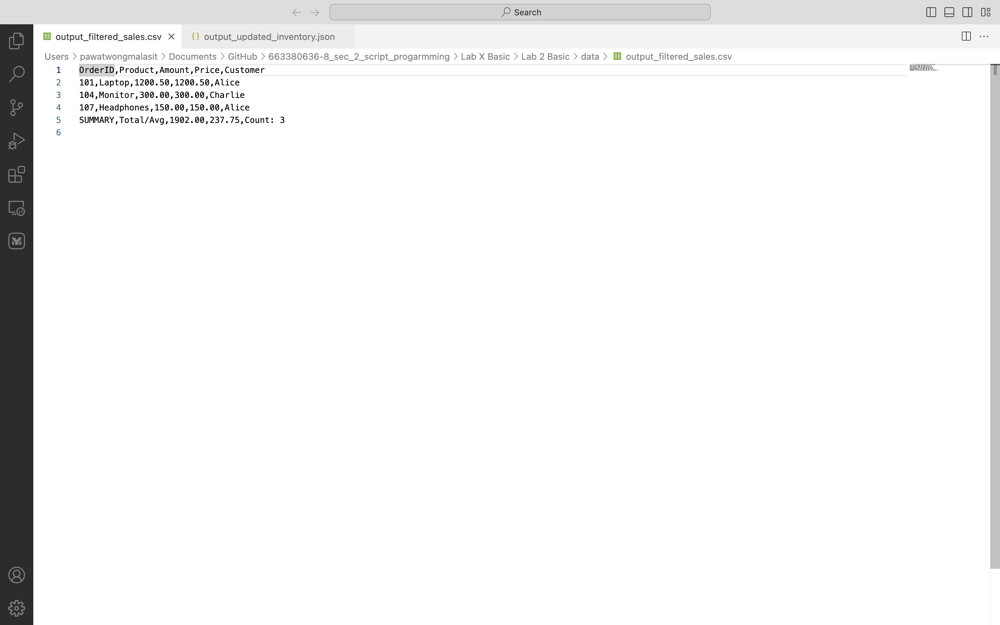
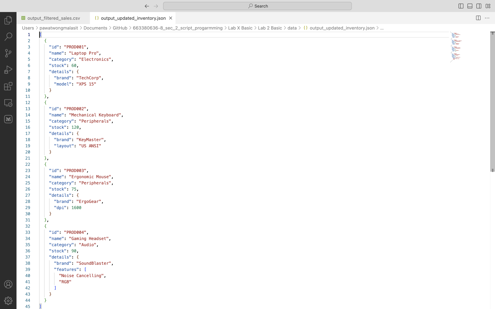

# Week 8 - Lab Basic: Automating with CSV and JSON Data

A data processor that reads, processes and writes **CSV** and **JSON** files with Python's built-in
`csv` and `json` modules.

## Results (screenshots)

### `data/output_filtered_sales.csv`


### `data/output_updated_inventory.json`


## What it does

**CSV workflow** (`input_sales.csv` → `output_filtered_sales.csv`)
1. Read the sales CSV as a list of dictionaries (`csv.DictReader`).
2. Calculate the total sales and the average item price of all orders.
3. Keep only orders with `Amount >= 100` (Laptop, Monitor, Headphones).
4. Add a `SUMMARY` row (total 1902.00, average price 237.75, count 3) and write the CSV (`csv.DictWriter`).

**JSON workflow** (`input_inventory.json` → `output_updated_inventory.json`)
1. Read the inventory (a list of nested product objects).
2. Update stock: `PROD001` 50 → 60, `PROD003` 80 → 75.
3. Add a new product `PROD004` (Gaming Headset) with nested `details`.
4. Write the result with `json.dump(..., indent=2, ensure_ascii=False)`. The input file is not modified.

## How to Run

```bash
cd "Lab X Basic/Week08 - Lab Basic"
python3 main.py
```

Standard library only - nothing to install.

## Project Structure

```
Week08 - Lab Basic/
├── src/
│   ├── __init__.py
│   ├── csv_handler.py   # CSVHandler: read / write / process sales data
│   ├── json_handler.py  # JSONHandler: read / write / update stock / add product
│   └── utils.py         # logging and directory helper
├── data/
│   ├── input_sales.csv
│   ├── input_inventory.json
│   ├── output_filtered_sales.csv       # output
│   └── output_updated_inventory.json   # output
├── screenshots/
├── main.py
└── README.md
```

## Error handling
* Missing file → logged error, workflow skipped (no crash).
* Invalid JSON → `json.JSONDecodeError` caught and logged.
* A sales row with a non-numeric amount/price → skipped with a warning.
* Updating a product ID that does not exist → warning; adding a duplicate product ID → not added twice.
