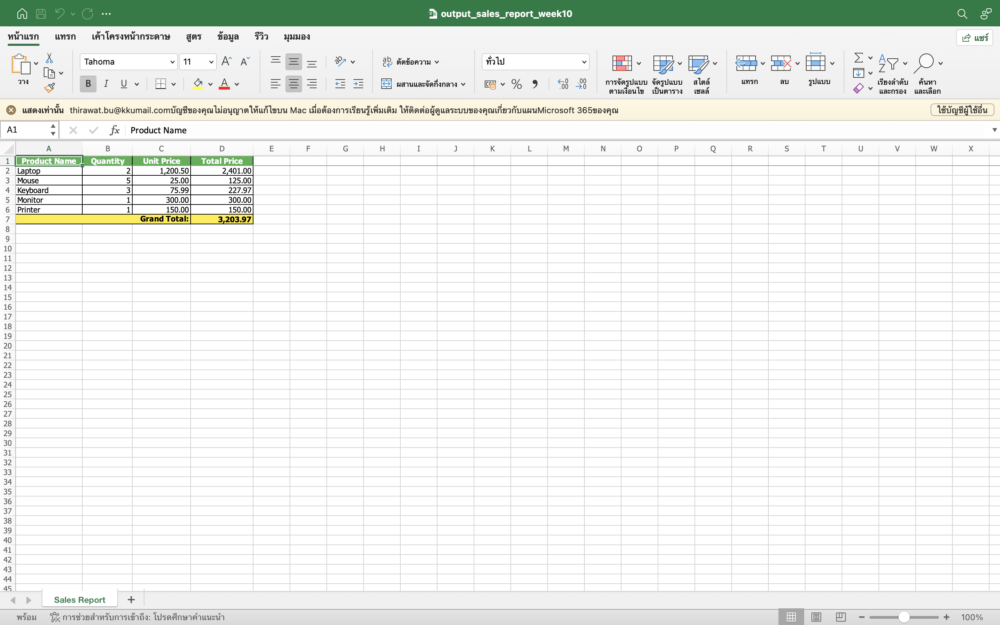

# Week 10 - Lab Basic: Automating Spreadsheets (Excel & Google Sheets)

A spreadsheet automator that reads sales data from an Excel file with **openpyxl**, calculates the
total price of each item and the grand total, and writes a formatted report to a new Excel file.

## Result (screenshot)

### `data/output_sales_report.xlsx` - sheet "Sales Report"


| Product Name | Quantity | Unit Price | Total Price |
|---|---:|---:|---:|
| Laptop | 2 | 1,200.50 | 2,401.00 |
| Mouse | 5 | 25.00 | 125.00 |
| Keyboard | 3 | 75.99 | 227.97 |
| Monitor | 1 | 300.00 | 300.00 |
| Printer | 1 | 150.00 | 150.00 |
| **Grand Total:** | | | **3,203.97** |

## How it works
1. `load_workbook()` opens `data/input_sales.xlsx` (columns: Product Name, Quantity, Unit Price).
2. Each row is read with `iter_rows(min_row=2, values_only=True)`; empty rows and rows with invalid numbers are skipped with a warning.
3. `Total Price = Quantity × Unit Price`, and all totals are added up for the grand total.
4. A new workbook gets a **Sales Report** sheet with:
   * a green, bold, centred header row,
   * thin borders and `#,##0.00` number format for prices,
   * a yellow **Grand Total** row whose label is merged across columns A–C,
   * auto-sized columns and a frozen header row.
5. The report is saved as `data/output_sales_report.xlsx`.

## How to Run

```bash
cd "Lab X Basic/Week10 - Lab Basic"
python3 -m venv venv
source venv/bin/activate          # Windows: venv\Scripts\activate
pip install -r requirements.txt
python create_sample_data.py      # creates data/input_sales.xlsx (already included)
python main.py                    # creates data/output_sales_report.xlsx
```

## Project Structure

```
Week10 - Lab Basic/
├── src/
│   ├── __init__.py
│   └── excel_processor.py   # ExcelProcessor: load / create / save workbooks, build the report
├── data/
│   ├── input_sales.xlsx          # sample input
│   └── output_sales_report.xlsx  # generated report
├── screenshots/
├── create_sample_data.py
├── main.py
├── requirements.txt
└── README.md
```

## Google Sheets (concept)
The same report could be written to Google Sheets with the `gspread` library: authenticate with a
service account (OAuth 2.0 credentials JSON), open the sheet with `gc.open_by_key(...)`, and write a
whole range at once with `worksheet.update("A1", rows)`. Local `.xlsx` automation needs no account
or network; Google Sheets is better when several people work on the same live spreadsheet.
