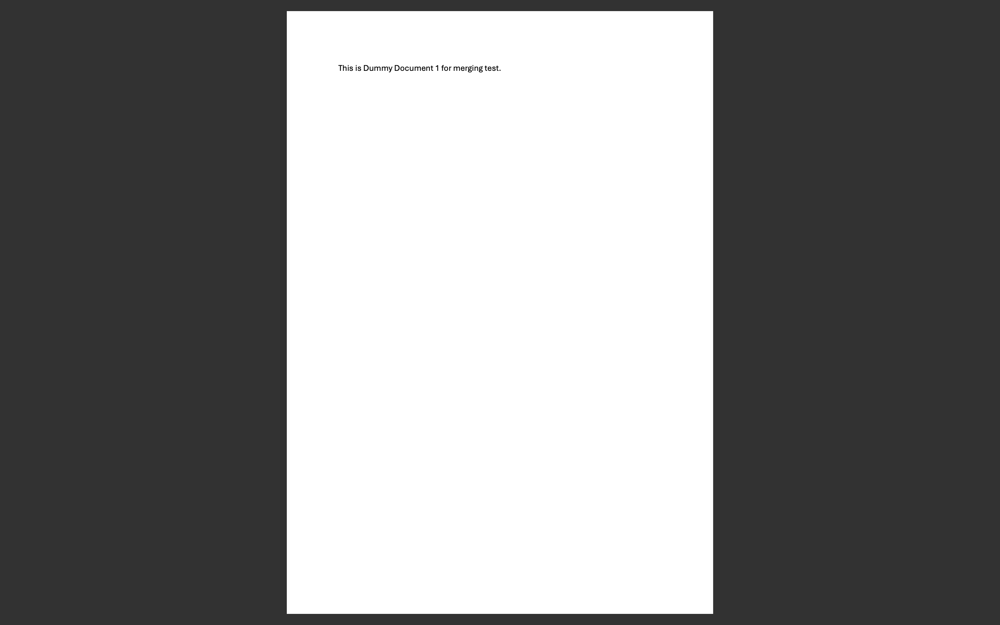
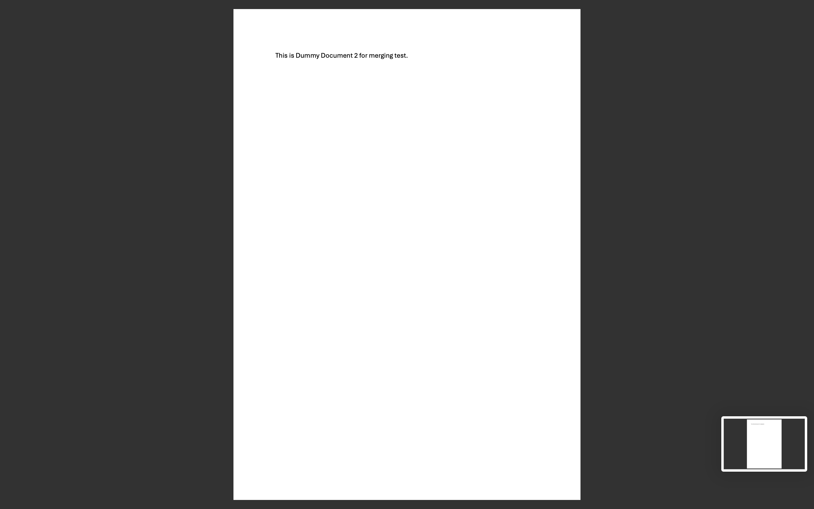
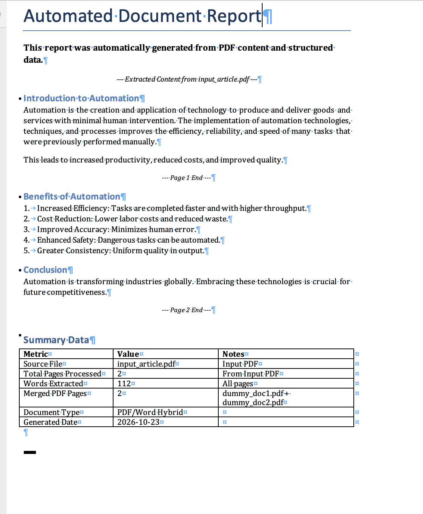

# Week 11 - Lab Basic: Automating PDFs & Word Documents

A document automator that **extracts text from a PDF** with `pypdf`, turns it into a formatted
**Word report** with `python-docx`, and **merges PDF files** into one.

## Results (screenshots)

### `documents/merged_output.pdf`
| Page 1 (dummy_doc1.pdf) | Page 2 (dummy_doc2.pdf) |
|---|---|
|  |  |

### `documents/output_report.docx`


## What it does

**Task 1 - PDF → Word report** (`input_article.pdf` → `output_report.docx`)
1. Extract the text of every page of `input_article.pdf` (2 pages).
2. Create a Word document with a title, a bold introduction and an italic centred note.
3. Write the article page by page, keeping its structure: short title lines become **headings**,
   `1. … 5.` lines become a **numbered list**, other text becomes justified paragraphs, and a
   `--- Page N End ---` marker follows each page.
4. Add a **Summary Data** table (source file, pages, words extracted, merged pages, date) with a bold header.

**Task 2 - Merge PDFs** (`dummy_doc1.pdf` + `dummy_doc2.pdf` → `merged_output.pdf`, 2 pages)

`PDFProcessor.split_pdf()` (split a PDF into parts) is also available.

## How to Run

```bash
cd "Lab X Basic/Week11 - Lab Basic"
python3 -m venv venv
source venv/bin/activate          # Windows: venv\Scripts\activate
pip install -r requirements.txt
python main.py
```

The input PDFs (`input_article.pdf`, `dummy_doc1.pdf`, `dummy_doc2.pdf`) are the files from the course
Google Drive folder and are already in `documents/`.

## Project Structure

```
Week11 - Lab Basic/
├── src/
│   ├── __init__.py
│   ├── pdf_processor.py    # PDFProcessor: extract text, merge, split
│   ├── word_processor.py   # WordProcessor: headings, paragraphs, tables, pictures, save
│   └── utils.py            # logging and directory helper
├── documents/
│   ├── input_article.pdf, dummy_doc1.pdf, dummy_doc2.pdf   # inputs
│   ├── output_report.docx                                  # output
│   └── merged_output.pdf                                   # output
├── screenshots/
├── main.py
├── requirements.txt
└── README.md
```

## Notes
* `pypdf` is the maintained successor of `PyPDF2` and has the same `PdfReader` / `PdfWriter` API.
* Missing input files are reported in the log instead of crashing; the merge is skipped if a dummy PDF is missing.
* If `output_report.docx` is open in Word while the script runs, saving fails with a clear message - close it and run again.
