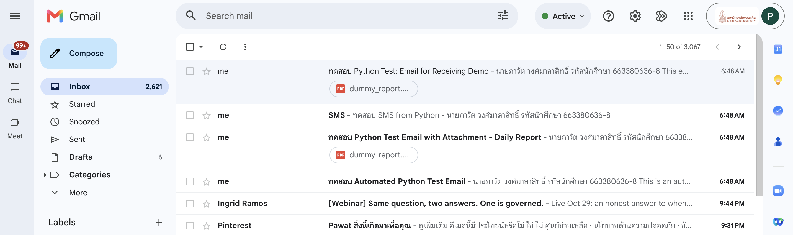

# Week 12 - Lab Basic: Automating Communications (Email & SMS)

**นายภาวัต วงศ์มาลาสิทธิ์ — 663380636-8**

Python scripts that **send emails** (plain text and with attachments) over SMTP, **send an SMS** through an
email-to-SMS gateway, and **read the inbox** over IMAP to find an email and download its attachment.
Every email body contains the student's full name and student ID.

## Result (screenshot)

Gmail inbox after running `python main.py`:



## Tasks in `main.py`

| Task | What happens |
|------|--------------|
| 1 | Send a plain-text email: **ทดสอบ Automated Python Test Email** |
| 2 | Send an email with `data/dummy_report.pdf` attached: **ทดสอบ Python Test Email with Attachment - Daily Report** |
| 3 | Send an SMS through an email-to-SMS gateway (see the note below) |
| 4 | Send **ทดสอบ Python Test: Email for Receiving Demo** to yourself, then search the inbox (UNSEEN, from me, subject), read it, download its attachment to `data/attachments/` and mark it as read |

A summary at the end shows OK / FAIL for each task.

> **SMS (Task 3):** email-to-SMS gateways exist only for some (mostly US) carriers, e.g. `1234567890` + `att` →
> `1234567890@txt.att.net`. Thai carriers have none, so `TEST_SMS_PHONE_NUMBER` is set to my own email address
> and the SMS text arrives as a short email titled "SMS". The lab instructions accept Task 3 not reaching a phone.

## How to Run

```bash
cd "Lab X Basic/Week12 - Lab Basic"
python3 -m venv venv
source venv/bin/activate          # Windows: venv\Scripts\activate
pip install -r requirements.txt
cp .env.example .env              # then fill in your Gmail address, App Password and STUDENT_INFO
python main.py --dry-run          # check everything without sending
python main.py                    # send and receive for real
python -m unittest discover tests -v   # 11 unit tests (SMTP/IMAP mocked, no email sent)
```

**Gmail App Password:** Google Account → Security → turn on 2-Step Verification → *App passwords* → create one and
put the 16 characters in `SENDER_APP_PASSWORD`. Use the App Password, not your normal password. `.env` is in
`.gitignore` and is never committed.

## Project Structure

```
Week12 - Lab Basic/
├── src/
│   ├── email_sender.py    # EmailSender: SMTP + STARTTLS, UTF-8 (Thai) subject/body, attachments, dry run
│   ├── email_receiver.py  # EmailReceiver: IMAP search/fetch, decode headers, save attachments
│   ├── sms_gateway.py     # SMSGateway: phone + carrier -> gateway address, 160-character SMS
│   └── utils.py           # logging, .env loading, directory helper
├── tests/test_automator.py
├── data/
│   ├── dummy_report.pdf   # attachment (from create_sample_files.py)
│   └── attachments/       # attachments downloaded in Task 4
├── screenshots/
├── create_sample_files.py
├── main.py
├── .env.example
├── requirements.txt
└── README.md
```

## Fixes compared to the example code
* IMAP search values with spaces (the subject) are quoted - unquoted values make the search fail.
* One IMAP connection is used for search + fetch, with real **UIDs**; emails are fetched with `BODY.PEEK[]` so only the
  code decides when an email is marked as read.
* Attachment names are reduced to their base name before saving (an email cannot write outside `data/attachments/`).
* The inbox search retries for a few seconds while Gmail delivers the demo email, instead of one fixed 10 s wait.
* `--dry-run` mode, a task summary, a clear message for a wrong App Password, and mocked unit tests.
