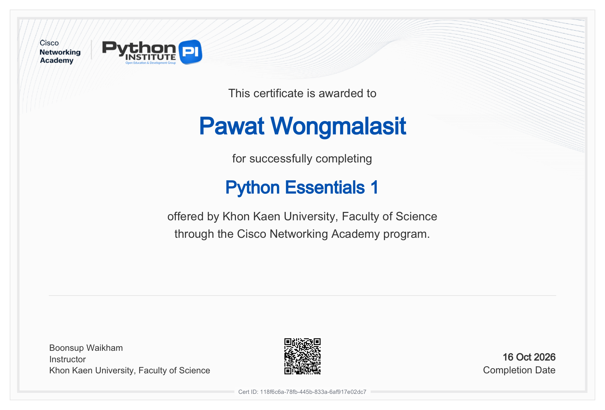

# CP352301 Script Programming 1/2569 — Section 2

| | |
|---|---|
| **ผู้จัดทำ** | นายภาวัต วงศ์มาลาสิทธิ์ (Pawat Wongmalasit) |
| **รหัสนักศึกษา** | 663380636-8 |

รวมงานทั้งหมดของรายวิชา แบ่งโฟลเดอร์ตามประเภทงาน

| โฟลเดอร์ | เนื้อหา |
|---|---|
| [Lab](Lab) | Lab ประจำสัปดาห์ (Week 1–6, 12) |
| [Class Activity](Class%20Activity) | Class Activity 1–4 (Week 7, 8, 10, 11) |
| [Lab X Basic](Lab%20X%20Basic) | LabX BASIC (Week 7, 8, 10, 11, 12) |
| [Lab X Advance](Lab%20X%20Advance) | LabX ADV (Week 7, 8, 10, 11, 12) |
| [mini Project](mini%20Project) | ระบบยืม-คืนหนังสือ (Library System) (ลิงก์ไปยัง repository ของกลุ่ม) |
| [Final Project](Final%20Project) | HOW DO YOU FISH (ลิงก์ไปยัง repository ของกลุ่ม) |
| [certificate](certificate) | Cisco NetAcad: Python Essentials 1 และ 2 |


## โครงสร้างไฟล์ (File Structure)

```
663380636-8_sec_2_script_progarmming/
├── Lab/                 Lab ประจำสัปดาห์
│   ├── Week01 … Week06/      ไฟล์ .ipynb (Lab, Activity, Recap)
│   └── Week12/               Final Project Development (Enhanced Task Manager)
├── Class Activity/      Class Activity 1–4
│   └── Week07 - Class Activity 1/ … Week11 - Class Activity 4/
├── Lab X Basic/         LabX BASIC
│   └── Week07 - Lab Basic/ … Week12 - Lab Basic/
├── Lab X Advance/       LabX ADV
│   └── Week07 - Lab Advance/ … Week12 - Lab Advance/
├── mini Project/        README.md สรุปโปรเจกต์ + ลิงก์ไปยัง repository ของกลุ่ม
├── Final Project/       README.md สรุปโปรเจกต์ + ลิงก์ไปยัง repository ของกลุ่ม
└── certificate/         ภาพ (.png) และไฟล์ PDF ของ certificate จาก netacad.com
```

**ส่วนที่ต่างจากโครงสร้างที่กำหนด**

* **เพิ่มโฟลเดอร์ `Class Activity/`** — แยก Class Activity 1–4 ออกจาก Lab ประจำสัปดาห์ ให้ตรงกับหัวข้อ *Class Activity* ใน Google Classroom
* **ตั้งชื่อโฟลเดอร์ย่อยตามสัปดาห์** (เช่น `Week07 - Lab Basic` แทน `Lab 1 Basic`) เพื่อให้ตรงกับชื่องานใน Classroom
  (*LAB Basic 1 (week 7)*, *Lab Basic Week 8*, *Week10_LabX BASIC* …) ใช้เลข 2 หลัก (`Week07`) เพื่อให้ GitHub เรียงลำดับสัปดาห์ถูกต้อง
* **mini Project และ Final Project เป็นงานกลุ่มใน repository อื่น** จึงใช้ไฟล์ `README.md` ที่สรุปงานและบทบาทของผู้จัดทำ พร้อมลิงก์ไปยัง repository นั้น
* แต่ละโปรเจกต์มี `README.md` ของตัวเอง อธิบายวิธีรัน ผลลัพธ์ และภาพ screenshot

---

## Lab — Lab ประจำสัปดาห์

| สัปดาห์ | หัวข้อ | ไฟล์ / โฟลเดอร์ |
|---|---|---|
| Week 1 | Introduction to Python & Basic Syntax | [Lab1.ipynb](Lab/Week01/Lab1.ipynb) · [Week1_recap.ipynb](Lab/Week01/Week1_recap.ipynb) |
| Week 2 | Control Flow: Conditionals | [lab2.ipynb](Lab/Week02/lab2.ipynb) · [Week2_recap.ipynb](Lab/Week02/Week2_recap.ipynb) |
| Week 3 | Control Flow: Loops | [Lab3.ipynb](Lab/Week03/Lab3.ipynb) · [Week3_recap.ipynb](Lab/Week03/Week3_recap.ipynb) |
| Week 4 | Data Structures: Lists & Tuples | [lab4.ipynb](Lab/Week04/lab4.ipynb) · [Week4_recap.ipynb](Lab/Week04/Week4_recap.ipynb) |
| Week 5 | Dictionaries & Sets | [Lab5.ipynb](Lab/Week05/Lab5.ipynb) · [Activity5.ipynb](Lab/Week05/Activity5.ipynb) |
| Week 6 | Functions & Modules | [Lab6.ipynb](Lab/Week06/Lab6.ipynb) · [Activity6.ipynb](Lab/Week06/Activity6.ipynb) · [my_utils.py](Lab/Week06/my_utils.py) |
| Week 12 | Final Project Development & Presentation (Enhanced Task Manager) | [Final_Project_Development_Task_Manager](Lab/Week12/Final_Project_Development_Task_Manager) |

## Class Activity

| สัปดาห์ | งานใน Classroom | โฟลเดอร์ |
|---|---|---|
| Week 7 | Class activity 1 : Building a Simple CLI Application | [Week07 - Class Activity 1](Class%20Activity/Week07%20-%20Class%20Activity%201) |
| Week 8 | Class_activity_2 : Object-Oriented Programming (OOP) Fundamentals & Refactoring the CLI Task Manager | [Week08 - Class Activity 2](Class%20Activity/Week08%20-%20Class%20Activity%202) |
| Week 10 | Class activity 3 : Interacting with Web APIs: Fetching and Processing JSON Data | [Week10 - Class Activity 3](Class%20Activity/Week10%20-%20Class%20Activity%203) |
| Week 11 | Class Activity 4 Project Planning & Design: Building an Enhanced Task Manager | [Week11 - Class Activity 4](Class%20Activity/Week11%20-%20Class%20Activity%204) |

## Lab X Basic

| สัปดาห์ | งานใน Classroom | โฟลเดอร์ |
|---|---|---|
| Week 7 | LAB Basic 1 (week 7): Introduction to Web Scraping (requests + BeautifulSoup) | [Week07 - Lab Basic](Lab%20X%20Basic/Week07%20-%20Lab%20Basic) |
| Week 8 | Lab Basic Week 8: Automating with CSV and JSON Data | [Week08 - Lab Basic](Lab%20X%20Basic/Week08%20-%20Lab%20Basic) |
| Week 10 | Week10_LabX BASIC: Automating Spreadsheets (Excel & Google Sheets) | [Week10 - Lab Basic](Lab%20X%20Basic/Week10%20-%20Lab%20Basic) |
| Week 11 | Week 11_LabX BASIC: Automating PDFs & Word Documents | [Week11 - Lab Basic](Lab%20X%20Basic/Week11%20-%20Lab%20Basic) |
| Week 12 | Week12_LabX BASIC: Automating Communications (Email & SMS) | [Week12 - Lab Basic](Lab%20X%20Basic/Week12%20-%20Lab%20Basic) |

## Lab X Advance

| สัปดาห์ | งานใน Classroom | โฟลเดอร์ |
|---|---|---|
| Week 7 | LabX ADV1: Advanced Web Scraping & Introduction to Automated Agents | [Week07 - Lab Advance](Lab%20X%20Advance/Week07%20-%20Lab%20Advance) |
| Week 8 | Week8_LabX ADV: Agentic Data Processing (Advanced CSV & JSON Workflows) | [Week08 - Lab Advance](Lab%20X%20Advance/Week08%20-%20Lab%20Advance) |
| Week 10 | Week10_LabX ADV: Advanced Spreadsheet Automation & Agentic Workflows | [Week10 - Lab Advance](Lab%20X%20Advance/Week10%20-%20Lab%20Advance) |
| Week 11 | Week11_ Project Planning & Design (LabX ADV: Agentic Document Automation) | [Week11 - Lab Advance](Lab%20X%20Advance/Week11%20-%20Lab%20Advance) |
| Week 12 | Week12_LabX ADV: Agentic Communication Workflows (Advanced Email & SMS) | [Week12 - Lab Advance](Lab%20X%20Advance/Week12%20-%20Lab%20Advance) |

## mini Project

**ระบบยืม-คืนหนังสือ (Library System)** — ระบบห้องสมุดแบบ Command-line (งานกลุ่ม) →
[รายละเอียดและสรุปโปรเจกต์](mini%20Project/README.md) ·
[GitHub Repository](https://github.com/Nathanelx/Mini-Project_G06_Sec2_Script_Programming)

## Final Project

**HOW DO YOU FISH** — เกมจำลองการตกปลาด้วยข้อมูลปลาจริงจาก Public API (งานกลุ่ม) →
[รายละเอียดและบทบาทของผู้จัดทำ](Final%20Project/README.md) ·
[GitHub Repository](https://github.com/suphachaikh-creator/Final-Project_G11_Sec2_Script_Programming)

## certificate

| | |
|---|---|
| Python Essentials 1 | [ภาพ](certificate/Python_Essentials_1.png) · [PDF](certificate/Python_Essentials_1_certificate_pawat-wo-kkumail-com_118f6c6a-78fb-445b-833a-6af917e02dc7.pdf) |
| Python Essentials 2 | [ภาพ](certificate/Python_Essentials_2.png) · [PDF](certificate/Python_Essentials_2_certificate_pawat-wo-kkumail-com_c1dc6cf2-d393-45cd-9574-1ca3ec56ff57.pdf) |



