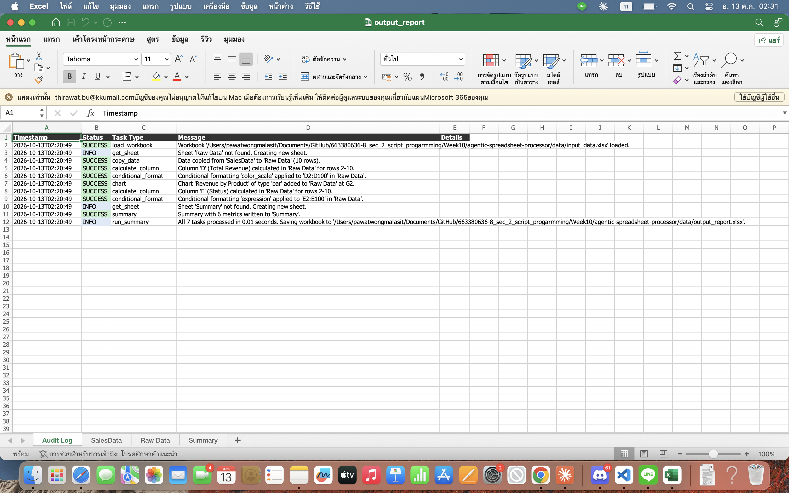
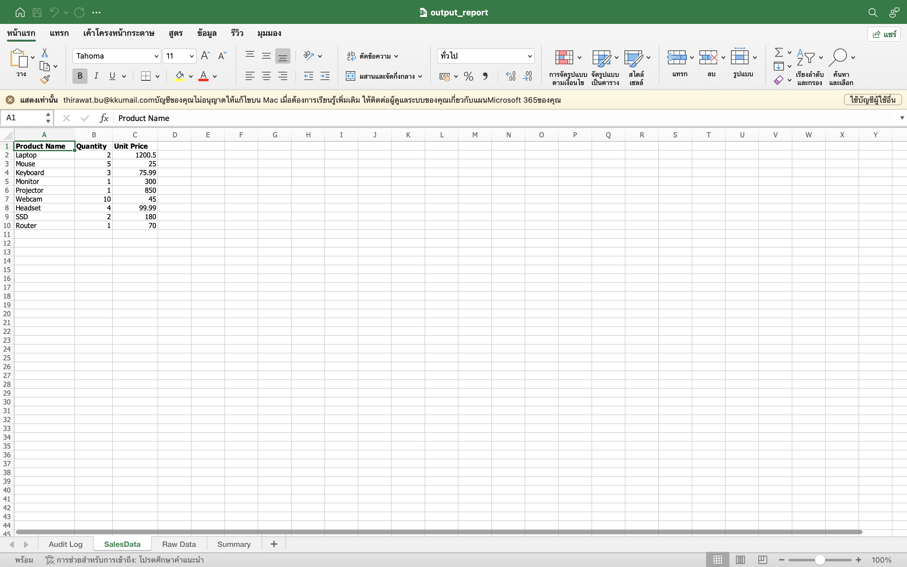
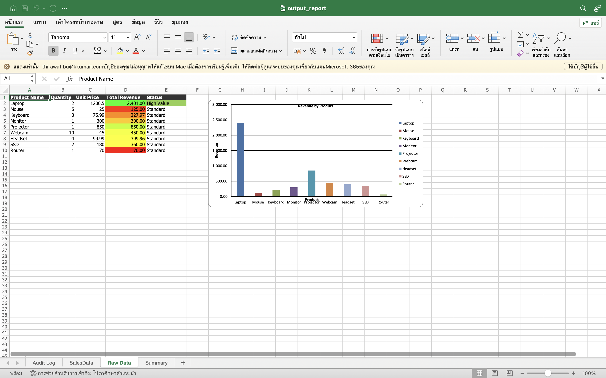
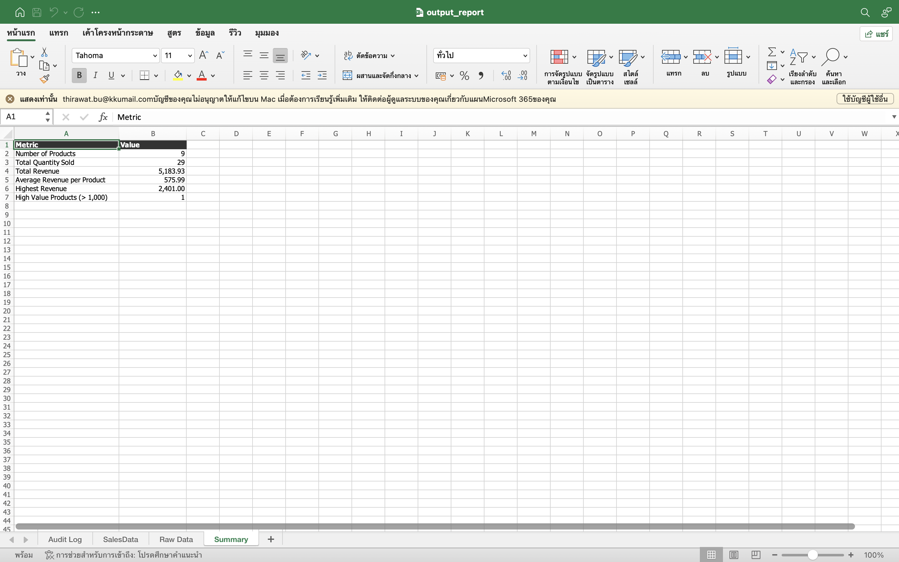

# Week 10 LabX ADV: Advanced Spreadsheet Automation & Agentic Workflows

An "Agentic Spreadsheet Processor" that runs a list of Excel tasks defined in a JSON config
(`configs/example_spreadsheet_config.json`) using `openpyxl`: copy data, add formula columns,
apply conditional formatting, create a chart, build a summary sheet, and write an
**Audit Log** sheet into `data/output_report.xlsx`.

## Results (screenshots of `data/output_report.xlsx`)

### Sheet: Audit Log


### Sheet: SalesData


### Sheet: Raw Data


### Sheet: Summary


## Agent tasks

| # | Task type | What it does |
|---|-----------|--------------|
| 1 | `copy_data` | Copies `SalesData` → `Raw Data` (values, formats, header style) |
| 2 | `calculate_column` | Column D **Total Revenue** = `=B{row}*C{row}` (`#,##0.00`) |
| 3 | `conditional_format` | 3-color scale (red → yellow → green) on `D2:D100` |
| 4 | `chart` | Bar chart **Revenue by Product** at `G2` |
| 5 | `calculate_column` | Column E **Status** = `=IF(D{row}>1000,"High Value","Standard")` |
| 6 | `conditional_format` | Expression rule: green fill when `$E2="High Value"` |
| 7 | `summary` | `Summary` sheet: product count, total quantity, total/average/max revenue, high-value count |

Every step (success / warning / error) is recorded in the **Audit Log** sheet, which is placed first in the workbook.

## How to Run

```bash
cd Week10/agentic-spreadsheet-processor
python3 -m venv venv
source venv/bin/activate          # Windows: venv\Scripts\activate
pip install -r requirements.txt
python create_dummy_data.py       # creates data/input_data.xlsx (sheet "SalesData")
python main.py                    # creates data/output_report.xlsx
open data/output_report.xlsx      # macOS: open in Excel / Numbers
```

> Formulas are written by `openpyxl` but calculated by Excel when the file is opened
> (the workbook is flagged to recalculate on load).

## Project Structure

```
agentic-spreadsheet-processor/
├── src/
│   ├── __init__.py
│   ├── spreadsheet_agent.py    # SpreadsheetAgent: task dispatcher + Excel operations + Audit Log
│   ├── config_parser.py        # loads and validates the JSON config
│   ├── utils.py                # logging helpers
│   └── google_sheets_utils.py  # placeholder for future Google Sheets integration
├── configs/
│   └── example_spreadsheet_config.json
├── data/
│   ├── input_data.xlsx         # sample input (from create_dummy_data.py)
│   └── output_report.xlsx      # generated report
├── screenshots/                # screenshots for the lab submission
├── create_dummy_data.py
├── main.py
├── requirements.txt
├── .gitignore
└── README.md
```

## Fixes compared to the lab handout code

* `main.py` used `from .src.utils import ...` (relative import in a script → `ImportError`); it now imports `from src....`.
* `config_parser.py` required a `sheet` field for every task, but `copy_data` uses `source_sheet` / `dest_sheet`, so the example config always failed validation.
* `spreadsheet_agent.py` used `json.dumps` without `import json` (crashed while writing the Audit Log).
* The `expression` conditional format called `conditional_formatting.add(range, ruleType=..., ...)`, which is not a valid `openpyxl` signature; it now builds a `Rule(type="expression", ...)`.
* The chart used `data_range` `D1:D5` with `category_range` `A1:A5`; because the data's first row is the series title, the labels were shifted by one row. Categories now start at `A2`, and the chart covers all products.
* `calculate_column` stops at the last row with data instead of `max_row`, and one failing task no longer stops the whole run.
* Added a `summary` task to build the **Summary** sheet listed in the lab goals.
