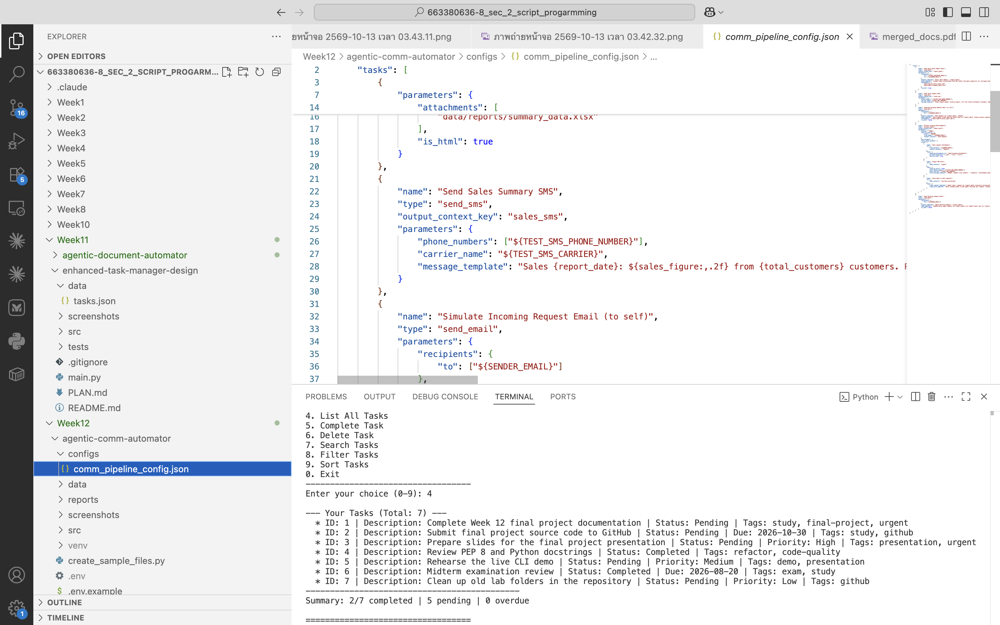
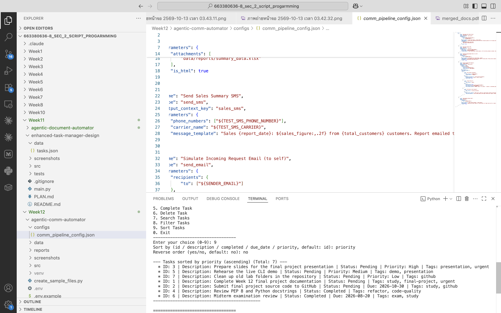

# Week 12 Final Project: Enhanced Task Manager CLI

| | |
|---|---|
| **Student** | Pawat Wongmalasit |
| **Student ID** | 663380636-8 |
| **Course** | CP352301 Script Programming 1/2569 - Sec 2 |

A command-line task manager built with OOP and a layered architecture. It supports three task types,
tags, and full **search, filter and sort**, saves everything to JSON, and never crashes on bad input.

## Screenshots





## Features

| Menu | Feature | Details |
|------|---------|---------|
| 1 | Add Normal Task | description + tags |
| 2 | Add Due Date Task | `YYYY-MM-DD`, re-asks on invalid dates (e.g. `2026-02-30`) |
| 3 | Add Priority Task | High / Medium / Low (case-insensitive) |
| 4 | List All Tasks | type-specific details, `(OVERDUE)` marker, summary line |
| 5 | Complete Task | by ID |
| 6 | Delete Task | by ID, with confirmation |
| 7 | **Search** | partial, case-insensitive match in description **or** tags |
| 8 | **Filter** | completed status, due date **before / after** (a range), priority, tags (must have all) - combined with AND |
| 9 | **Sort** | id, description, completed, due_date, priority - ascending or descending |
| 0 | Exit | |

Tags are normalized (trimmed, lower-case, no duplicates), so `GitHub`, ` github` and `github` are the same tag.

## How to Run

```bash
cd "mini Project/final_task_manager_project"
python3 main.py                       # start the CLI
python3 main.py --debug               # also show debug log lines in the terminal
python3 -m unittest discover tests    # 24 unit tests
```

Python 3.8+ and the standard library only. `data/tasks.json` contains 7 demo tasks (all three types, with tags,
pending and completed). Actions are logged to `logs/task_manager.log`.

## Architecture

```
main.py ──> CLIInterface ──> TaskManager ──> DataPersistence ──> data/tasks.json
            (input/output)   (business logic)  (JSON <-> objects)
                                   │
                                   └──> Task / DueDateTask / PriorityTask  (data models)
```

| Module | Responsibility |
|--------|----------------|
| `src/task.py` | `Task` base class; `DueDateTask` and `PriorityTask` inherit and override `to_dict()` / `_detail_parts()` |
| `src/data_persistence.py` | JSON load/save; rebuilds the right class from `_type`; skips invalid entries; atomic save |
| `src/task_manager.py` | add / complete / delete, `search_tasks`, `filter_tasks`, `sort_tasks`, `summary` - no `input()`/`print()` |
| `src/cli_interface.py` | menu, prompts, input validation, display |
| `main.py` | sets up logging and connects `TaskManager` to `CLIInterface` |

More detail - requirements, design decisions, challenges and lessons learned - is in [PLAN.md](PLAN.md).
The presentation outline and demo script are in [PRESENTATION.md](PRESENTATION.md).

## Project Structure

```
final_task_manager_project/
├── src/
│   ├── __init__.py
│   ├── task.py
│   ├── data_persistence.py
│   ├── task_manager.py
│   └── cli_interface.py
├── tests/
│   ├── test_task.py
│   └── test_task_manager.py
├── data/tasks.json
├── screenshots/
├── main.py
├── PLAN.md
├── PRESENTATION.md
├── .gitignore
└── README.md
```

## Known limitations
* Tasks cannot be edited after creation (only completed or deleted).
* One task has one type - a task cannot have both a due date and a priority.
* The JSON file is rewritten on every change, which is fine for hundreds of tasks but not for very large lists.
